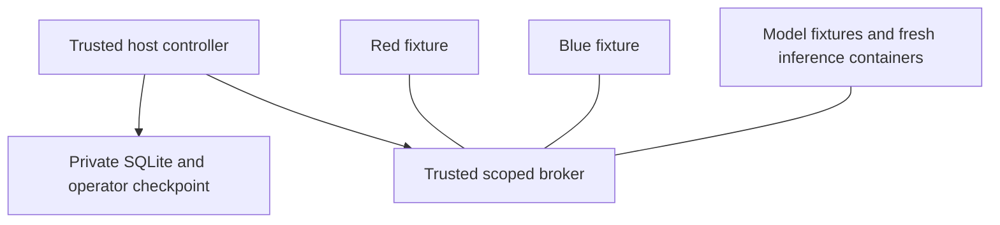

# Architecture and threat model

## Components

The host operator runs `server.py` and the serial controller. Browser requests require a random bearer credential. The app binds to loopback, validates Host and Origin and uses no permissive CORS policy. Credentials are held in page memory. HTTP is acceptable only for this local workflow; public multi-user deployment is not supported.

`storage.py` stores run metadata, credential hashes and ordered events in SQLite. Checkpoints live in a separate operator directory never mounted into workloads. Completed summary fields are reconstructed from verified events rather than trusted mutable summary rows. Keep an original checkpoint outside the host for stronger independent retention; this prototype does not implement an external witness.

`runtime.py` invokes Docker with argument lists, no shell, and fixed operations. Request bodies cannot supply image names, commands, filesystem mounts or runtime flags. Image tags are resolved to local image IDs before workloads start. The only configurable model path comes from the trusted operator's environment and is mounted read-only into a model container.

## Docker topology

The three workload connections represent three distinct private networks. No direct red-to-blue or red-to-model connection is intended. The broker has multiple network interfaces but exposes fixed HTTP operations and does not forward arbitrary URLs. No Docker socket is mounted in any container. The host controller is the only Docker client.

The **network fixture** for the model is a healthy TCP listener on the model network, allowing direct connectivity tests while the actual llama.cpp containers are sequential short-lived processes on that same network. The listener is not the inference engine. Inference begins only after broker/network prechecks pass, controlled by the host. The application does not yet implement streaming inference through the broker or arbitrary blue defence code execution.

## Lifecycle

CREATED → PRECHECK → RUNNING → VERIFYING → COMPLETE.

A failed precheck may move PRECHECK → VERIFYING directly. Weak profile performs an in-process synthetic forbidden operation and halts. Missing Docker also halts before workload execution, recording an error. Cleanup is attempted in the controller's finally path before completion and sealing. Cleanup errors prevent a valid verdict. A hard process kill can interrupt cleanup; there is no automatic crash recovery.

## Required check semantics

| Check | What PASS means | What it does not prove |
|---|---|---|
| Authorization | Local scope controls plus real container broker HTTP positive/negative probes passed | Every possible API attack is prevented |
| Network | Fixture health, allowed broker connection, denied direct DNS/IP probes, bounded external connection denial and inspected resource configuration passed | Universal egress or host-escape protection |
| Real model | Three bounded actual llama.cpp invocations returned generated output | Accuracy or comprehensive model safety |
| Fresh session | Separate container IDs; exact-token positive control worked; token absent from clean output | Universal memory erasure or side-channel resistance |
| Cleanup | Created containers/networks removed successfully, or none created | Crash recovery after host/process failure |
| Evidence | Final event chain verifies against retained checkpoint | A malicious host cannot rewrite chain and checkpoint together |

FAIL means a measured requirement was violated. ERROR means the measurement could not be completed or its positive control failed. NOT_RUN means no measurement exists. Any FAIL yields INVALID. All six checks must PASS with a complete sealed run for VALID_UNDER_TESTED_MANIFEST. All remaining combinations are INCONCLUSIVE.

## Explicit exclusions

Host kernel compromise, malicious operator/controller, GPU/cache timing, arbitrary user-supplied exploit execution, distributed concurrency, public SaaS authentication, external timestamp/witness anchoring, automated crash recovery, full prompt-injection evaluation, red/blue developer IDEs and a general model proxy are outside this prototype.
